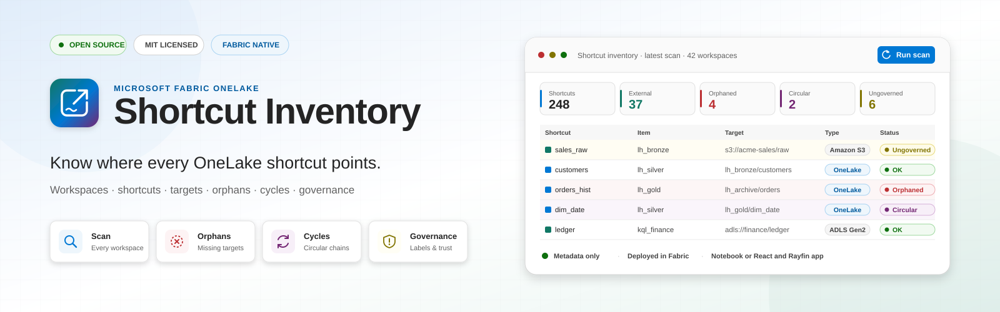
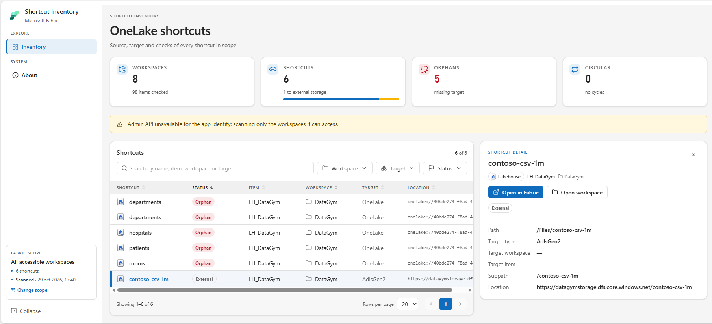
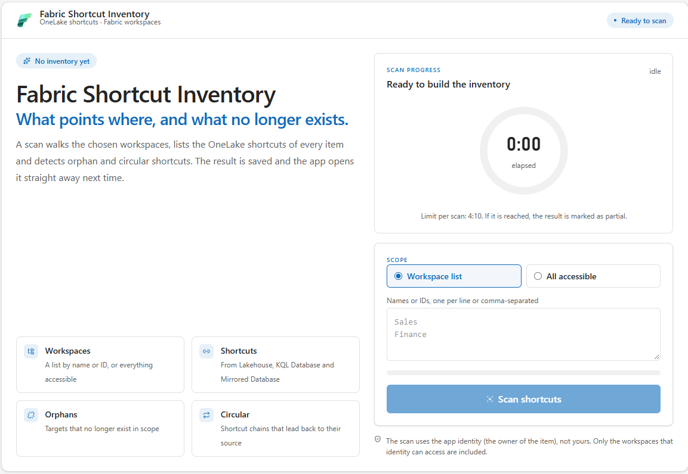
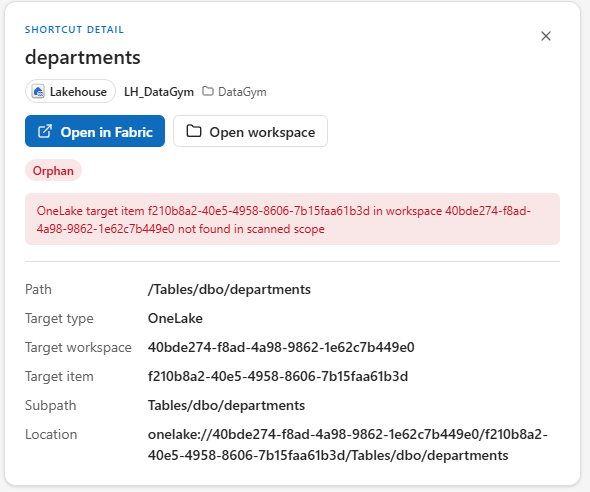
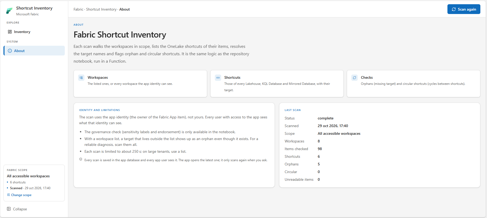
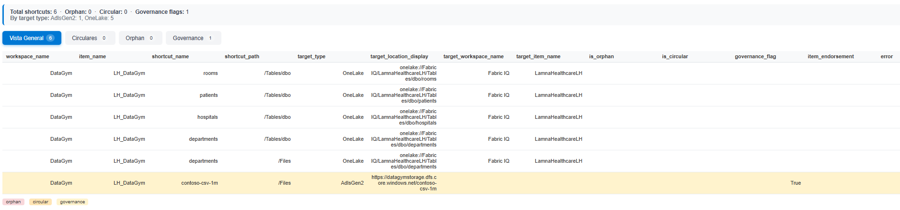

# Fabric Shortcut Inventory

A **Fabric App** that scans Microsoft Fabric workspaces and builds a **complete inventory of OneLake shortcuts**, detecting **orphaned** and **circular** shortcuts and those pointing to **external storage**. Scans are saved, so the app opens the latest one straight away.

A **notebook** is also included as an alternative, for scheduled runs, governance checks and persistence to a Delta table.



## Why?

OneLake shortcuts are easy to create and hard to govern: over time you accumulate shortcuts pointing to deleted items, circular chains between lakehouses, and connections to external storage (S3, ADLS, GCS…) with no sensitivity label or endorsement whatsoever. Fabric offers no centralized view of any of this. This project builds one in a single scan.

## What it checks

1. **Discovers workspaces**: the entire tenant (with admin permissions) or a specific list, by name or ID.
2. **Discovers items**: lists the items in each workspace via the [Fabric REST API](https://learn.microsoft.com/rest/api/fabric/).
3. **Extracts shortcuts**: in parallel, from the item types that support them (Lakehouse, KQL Database, Mirrored Database).
4. **Parses targets**: normalizes OneLake targets (workspace/item/path) and external ones (Amazon S3, ADLS Gen2, Google Cloud Storage, S3 compatible, Dataverse, Azure Blob Storage, OneDrive/SharePoint).
5. **Validates**:
   - **Orphaned**: the target item no longer exists within the scanned scope.
   - **Circular**: shortcut chains that form a cycle (DFS detection over the dependency graph).
   - **Governance** (notebook only): external shortcuts on items with no sensitivity label and no endorsement (`Certified`/`Promoted`).
6. **Resolves names**: turns target GUIDs into human-readable names, even for targets outside the scanned scope.

## Which one to use

| | Fabric App | Notebook |
|---|---|---|
| How it runs | From the browser, on demand | In a Fabric notebook, manual or scheduled |
| Identity | The app identity (owner of the Fabric App item) | The notebook user or a service principal |
| Result | Saved in the app database; the latest scan opens on start | HTML report in the notebook, optional Delta table |
| Orphan and circular checks | ✅ | ✅ |
| Governance check | — | ✅ (requires admin) |
| Time limit | ~250 s per scan | None |

## Fabric App

Built with [Rayfin](https://www.npmjs.com/package/@microsoft/rayfin-cli) in [`app/`](app/).

### Scan

The home page explains what is checked and collects the scope: a list of workspaces (names or IDs) or every accessible workspace. A ring shows the elapsed time against the scan limit.



### Inventory

After a scan, the inventory shows the global figures (workspaces, shortcuts, orphans, circular), any scan notices, and a table of shortcuts with:

- **Search** by name, item, workspace or target.
- **Filters** by workspace, target type and status (Orphan, Circular, External, No flags).
- **Sorting** by any column and paging.

Selecting a row opens its **detail**: the target, the reason it is orphaned or the cycle it belongs to, and links to the item and the workspace in the Fabric portal.



### About

Explains what the app checks, under which identity, its limitations, and the figures of the last scan.



### How it works

- The scan runs in the `scanShortcutInventory` Function with the **app identity** (the owner of the Fabric App item), not the identity of the user who opens it. Every user with access to the app sees what that owner can see.
- Scanning every workspace uses the admin API when the app identity is a Fabric administrator; otherwise it falls back to the workspaces that identity can access, and says so in a notice.
- Every scan is **saved** in the app database (Rayfin `data` service, a SQL Database in Fabric), keeping the history. Opening the app shows the latest saved scan without scanning again; a scan runs only when you ask for it. Saved scans are visible to every app user.

### Deploy

```bash
cd app
npm install
npm test          # inventory logic + frontend
npx rayfin up     # deploys to a Fabric workspace (asks for confirmation)
npm run dev       # local development against the active deployment
```

## Alternative: notebook

[`shortcut_inventory.ipynb`](shortcut_inventory.ipynb) runs the same checks in a Fabric notebook, adds the **governance** check, renders an interactive HTML report and can persist the inventory to a Delta table.



### Requirements

- A **Microsoft Fabric notebook** (it uses `notebookutils`, `sempy` and `displayHTML`; it will not run outside Fabric without adaptation).
- Permissions: at minimum the **Viewer** role on the workspaces to be scanned.
  - `SCOPE_MODE = "all"` with full tenant coverage → requires a **Fabric administrator**.
  - `GOVERNANCE_CHECK = True` → requires admin (uses the `sempy` *admin scan*); if permissions are missing, it degrades gracefully instead of failing.
- For `AUTH_MODE = "sp"`: a service principal with access to the Fabric API and its secret stored in **Azure Key Vault**.

### Usage

1. Import `shortcut_inventory.ipynb` into a Fabric workspace.
2. Adjust the **parameters** cell (see the table below).
3. Run all cells in order. The HTML report appears at the end.

### Parameters

| Parameter | Values | Description |
|---|---|---|
| `SCOPE_MODE` | `"all"` \| `"list"` | `"all"` scans the whole tenant (or the accessible workspaces if you are not an admin). `"list"` limits to `WORKSPACE_LIST`. |
| `WORKSPACE_LIST` | list of `str` | Workspace names or IDs. Only with `SCOPE_MODE = "list"`. |
| `RESOLVE_NAMES` | bool | Allows using display names (in addition to GUIDs) in `WORKSPACE_LIST`. |
| `AUTH_MODE` | `"user"` \| `"sp"` | `"user"`: delegated token of the notebook user. `"sp"`: service principal (recommended for scheduled runs). |
| `SP_TENANT_ID` | GUID | Entra ID tenant (only `"sp"`). |
| `SP_CLIENT_ID` | GUID | Client ID of the app registration (only `"sp"`). |
| `SP_KEYVAULT` | URL | Key Vault where the SP secret lives — the secret is never written into the notebook. |
| `SP_SECRET_NAME` | `str` | Name of the secret in the Key Vault. |
| `GOVERNANCE_CHECK` | bool | Enriches with sensitivity/endorsement and computes `governance_flag`. |
| `SAVE_TO_DELTA` | bool | Saves the result to a Delta table (overwrite mode). |
| `DELTA_TABLE` | `str` | Name of the target Delta table. |
| `MAX_WORKERS` | int | Parallel threads for the shortcuts API. Lower it if you see throttling (429). |

### HTML report

The report renders inside the notebook itself, with no external dependencies:

- **Summary** with totals (shortcuts, orphaned, circular, governance flags) and a breakdown by target type.
- **Tabs**: Overview, Circular, Orphan and Governance, each with its own counter.
- **Per-row colors**: 🟥 orphaned · 🟧 circular · 🟨 governance flag.

## Output schema

The app and the notebook produce the same columns. Each inventory row is a shortcut (or a per-item extraction error):

| Column | Description |
|---|---|
| `scan_timestamp` | Scan time (UTC, ISO 8601). |
| `workspace_id` / `workspace_name` | Workspace that contains the shortcut. |
| `item_id` / `item_name` / `item_type` | Item (lakehouse, etc.) that contains the shortcut. |
| `shortcut_name` / `shortcut_path` | Name and path of the shortcut within the item. |
| `target_type` | `OneLake` or the external storage type. |
| `target_workspace_id` / `target_workspace_name` | Target workspace (OneLake only). |
| `target_item_id` / `target_item_name` | Target item (OneLake only). |
| `target_subpath` | Subpath within the target. |
| `target_location` / `target_location_display` | Target URI (with GUIDs / with readable names). |
| `is_external` | `True` if it points to storage external to OneLake. |
| `is_orphan` / `orphan_reason` | Non-existent target within the scanned scope, and the reason. |
| `is_circular` / `circular_path` | Edge that participates in a shortcut cycle. |
| `item_sensitivity_label` / `item_endorsement` | Governance metadata of the containing item (notebook only). |
| `governance_flag` | External shortcut with no sensitivity and no endorsement (notebook only). |
| `error` | API error while extracting the item's shortcuts, if any. |

## Known limitations

- Only **Lakehouse**, **KQLDatabase** and **MirroredDatabase** expose the shortcuts endpoint; other item types are skipped.
- Orphan detection is evaluated **against the scanned scope**: with a workspace list, a target living in a workspace outside the list shows up as orphaned even if it exists. For a reliable diagnosis, scan every workspace.
- Fabric App: each scan is limited to ~250 s by the Functions host; when the limit is reached, the result is marked as partial. For large tenants, use a workspace list or the notebook.
- Notebook: governance enrichment depends on the `sempy` *admin scan* and admin permissions; without them, those columns stay empty.
- Notebook: Delta persistence uses `overwrite` mode; switch to `append` in the last cell if you want to keep history.

See [CHANGELOG.md](CHANGELOG.md) for the version history.

## License

[MIT](LICENSE) — free to use, modify and redistribute with attribution.
